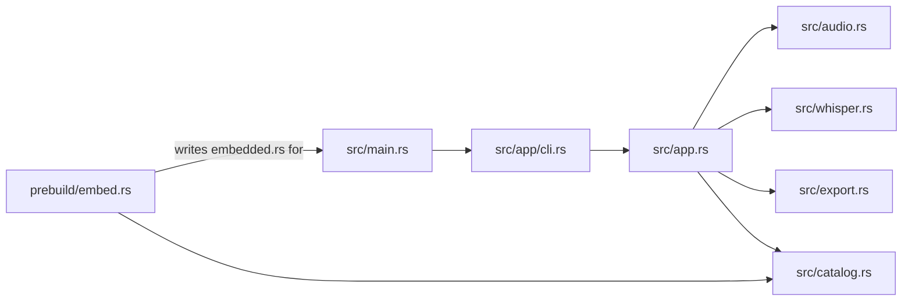

# speech-to-text: maintainer's guide

1. [Build the executable](#build-the-executable)
2. [How the code works](#how-the-code-works)
   - [Files and folders](#files-and-folders)
   - [Diagram](#diagram)
   - [From audio file to transcript](#from-audio-file-to-transcript)
   - [The window and the worker](#the-window-and-the-worker)
   - [The command line](#the-command-line)
   - [The models](#the-models)
   - [Build settings](#build-settings)
   - [Tests](#tests)
   - [Rules for changing the code](#rules-for-changing-the-code)

## Build the executable

Do this after every change to the code, and whenever a dependency is updated. Build on Windows for the Windows
executable and on Linux for the Linux one; the steps are the same. You need:

- Windows 10 or 11, 64-bit, or Linux on x86-64, such as Ubuntu; about 15 GB of free disk.
- About 14 GB of free memory for step 3. Compiling the 1.4 GB of models into the executable takes that much; close
  big programs first.
- Rust, from <https://rustup.rs>. Accept the defaults.
- A linker for Rust. On Windows: Visual Studio, or its Build Tools, with "Desktop development with C++". On Ubuntu:
  `sudo apt install build-essential curl`.
- An internet connection for the first build, which downloads the dependencies and 1.4 GB of models.
- About fifteen minutes for the first build; later builds take a few minutes.

1. **Open a terminal in the project's folder.** PowerShell, Git Bash or a Linux shell.
2. **Run the tests.**

   ```
   cargo test
   ```

   The first run downloads the models into `models/` and compiles the dependencies. It ends with
   `test result: ok. 22 passed`.
   - `could not download https://...`: the connection failed, or the file has moved. Run the command again; files
     already downloaded are kept. If one address keeps failing, see [The models](#the-models).
   - `curl is needed to download the models`: `curl.exe` comes with Windows 10 and 11; check that
     `C:\Windows\System32` is on the `PATH`. On Linux, install `curl`.
   - `linker link.exe not found` or `linker cc not found`: install the linker listed above.
   - A test fails: its name starts with its number. Look the number up in [TESTS.md](TESTS.md) to see what it
     protects.
3. **Build the executable.**

   ```
   cargo build --release
   ```

   The result is `target\release\speech-to-text.exe` on Windows, `target/release/speech-to-text` on Linux, about
   1.4 GB, with the models inside it.
   - `rustc-LLVM ERROR: out of memory`: there was not enough free memory. Close other programs and run it again.
4. **Try it.** Start the executable, drop `tests\fixtures\fox_vorbis.ogg` on its window, and wait for "The quick
   brown fox jumps over the lazy dog." Press **Export as .md** and open the file it saves. Then try the command
   line from the project's folder; it prints the same sentence:

   ```
   target/release/speech-to-text transcribe tests/fixtures/fox_vorbis.ogg --model tiny
   ```
5. **Check the rules**, in Git Bash:

   ```
   bash .github/scripts/check-rules.sh
   ```

   Every line should say `ok`. A `FAIL` names the file and the rule.
6. **Record the change** in the last part of `documentation/DEVLOG/`, then commit. The executable is not committed;
   attach it to a release on GitHub instead.

## How the code works

The program is a window and a command line, in one executable. The user gives it an audio file; a worker thread
turns the file into samples, lets one of three Whisper models turn the samples into a transcript, and sends the
transcript back: to the window, where it is shown in a text field and can be copied or exported, or to the command
line, which prints or exports it. Everything is written in Rust, and the dependencies that end up in the executable
are Rust too, on Windows and on Linux.

### Files and folders

| File or folder | What it holds |
| --- | --- |
| `src/main.rs` | The program's start: it hands `embedded`, and the arguments it was given, to `cli::start`. |
| `src/lib.rs` | The list of modules, `Failure`, the one kind of error the program has, and `embedded`, which `prebuild/embed.rs` writes; see [The models](#the-models). |
| `src/app.rs` | The window (`App`), the worker (`serve`), and what they send each other (`Job`, `Event`). |
| `src/app/cli.rs` | The command line: `parse` reads the arguments, `start` opens the window or answers in the terminal. In `src/app/` because `src/` holds the 7 files Rule 14 allows. |
| `src/audio.rs` | `decode`: an audio file in, samples out. |
| `src/whisper.rs` | `Transcriber`: samples in, transcript out. |
| `src/export.rs` | `ExportFormat` and `export`: the transcript as a `.txt` or `.md` file. |
| `src/catalog.rs` | `Model`: the list of models. The only place that names them. |
| `prebuild/embed.rs` | Runs before every build: downloads the models and writes the code that hands them to `main.rs`; on Windows also the manifest, see [The command line](#the-command-line). |
| `tests/suite.rs` | All the tests. |
| `tests/fixtures/` | The fixtures: one sentence spoken by a computer voice in five formats, a 34-second recording, and six seconds of silence. |
| `Cargo.toml` | The dependencies and the build settings; see [Build settings](#build-settings). |
| `Cargo.lock` | The exact versions of all dependencies, written by Cargo. Commit it; do not edit it. |
| `.cargo/config.toml` | Makes the Windows executable run without the Visual C++ runtime installed. |
| `models/` | The downloaded models. Not in Git; `prebuild/embed.rs` fetches what is missing. |
| `target/` | Everything Cargo builds. Not in Git; safe to delete, at the cost of a full rebuild. |
| `documentation/` | This guide, `RULES.md`, `REQUIREMENTS.md`, `TESTS.md`, `DECISIONS.md`, `TERMINOLOGY.md`, and the development log in `DEVLOG/`. |
| `README.md` | Introduces the project. |
| `LICENSE` | The terms under which anyone may use the project. |
| `AGENTS.md` | What an AI agent must know before it changes anything here: what to read first, what it must never do, and when a change is done. |
| `CLAUDE.md` | The same for Claude Code, which reads this file by itself. It loads `AGENTS.md` and `RULES.md`. |
| `.claude/skills/` | Step-by-step procedures for AI agents, one folder each, such as how to write the development log. `ub-mode` is copied from another project and keeps its licence beside it. |
| `.claude/settings.json` | Stops Claude Code from committing and from changing `REQUIREMENTS.md`. |
| `.github/` | What GitHub shows contributors: how to contribute, report a bug or a security hole, and the pull request form. |
| `.github/workflows/checks.yml` | Tells GitHub to run the checks and the tests on every push and pull request. |
| `.github/scripts/check-rules.sh` | Checks the rules a script can check; see [Tests](#tests). |
| `.gitattributes`, `.gitignore` | How Git treats line endings, and which files it leaves out. |

### Diagram



### From audio file to transcript

1. **`audio::decode`** opens the file with symphonia, which reads Ogg, WAV, MP3, FLAC and MP4/M4A. It decodes the
   first audio track packet by packet, averages the channels into one, and brings the result to 16 000 samples a
   second with rubato. symphonia has no Opus decoder, so a track that is Opus (voice notes are) goes to the
   `opus-decoder` crate instead, which can give 16 000 samples a second directly. That choice is the `Codec` enum.
2. **`whisper::chunks`** cuts the samples into chunks. A model takes 30 seconds at a time. A cut in the middle of a
   word would lose the word, so each cut is made at the quietest tenth of a second in the last five seconds of the
   30.
3. **`Transcriber::transcribe`** handles one chunk at a time. `encode` turns it into a picture of the sound (a mel
   spectrogram) and runs the model's first half on it. The second half remembers what it worked out from the
   chunk before, so `encode` also makes it forget (`reset_kv_cache`); nothing else has to. `opening` then asks the
   second half for its first judgement of the chunk, a list of odds.
4. One of those odds says how likely it is that the chunk holds no speech. Over 0.6, the chunk is left out. Without
   this, a model makes text up: for six seconds of silence it wrote "you". Speech scores about 0.002, silence and
   hum over 0.8.
5. From the same odds `language` reads which language is spoken, once, for the first chunk that has speech. `decode`
   then lets the model write the text one token (a word or part of one) at a time, always taking the likeliest,
   until it writes its end mark.
6. The chunks' texts are joined with spaces. If there is none, the outcome is the failure "No speech was found in
   the audio file."

Example: `long_vorbis.ogg` is 34 seconds, so it becomes two chunks, cut somewhere between second 25 and 30. Test 6
checks that the whole transcript, both chunks, comes out as expected.

To support another kind of audio file, turn on its feature of `symphonia` in `Cargo.toml` and add its ending to
`AUDIO` in `src/app.rs`, which is the list the Open dialog shows.

### The window and the worker

A transcription takes from seconds to minutes, and the window must not freeze meanwhile. So there are two threads
that share nothing and only send each other messages:

- The window, `App`, sends a `Job` (an audio file and the chosen model) when the user opens or drops a file. While a
  job is under way the controls are disabled and a dropped file is ignored, so there is never more than one job.
- The worker, `serve`, takes one job at a time and sends back `Event::Progress` after every chunk and
  `Event::Finished` at the end, with either the transcript or a `Failure`. After each event it wakes the window.

`App::show` draws the whole window on every frame: it first reads the events that have arrived (`receive`), then
draws the controls, the status line (`report`), the text field and the buttons (`actions`). What the status line says
is decided by the `Status` enum alone.

The worker keeps the last model it loaded, because loading takes a few seconds; a job with another model replaces it.
If a transcription crashes inside a dependency, `serve` reports a `Failure` instead of leaving the window waiting
forever.

The window never opens a file dialog itself. It asks a `Dialogs`, and the real one, `Native`, shows the system's
dialogs. This is what lets the tests press "Open audio file…" and "Export as .md" without a human: they pass in
their own `Dialogs` that answers at once. On Linux the dialogs need xdg-desktop-portal, which GNOME and KDE have;
without it the buttons do nothing.

### The command line

`cli::start`, in `src/app/cli.rs`, is where the program starts. It reads the arguments with `parse`:

| Arguments | What happens |
| --- | --- |
| none | The window opens. |
| an audio file | The window opens and transcribes it at once, as Explorer's "Open with" asks. |
| `transcribe <audio file> [--model tiny\|base\|small] [--format txt\|md] [--output <file>]` | A transcription in the terminal. |
| `--help`, `--version` | The usage, or the version from `Cargo.toml`, is printed. |

A transcription in the terminal runs the same worker as the window: `transcribe` hands `serve` its one job on a
thread of its own, and `outcome` reads the events that come back. `deliver` then prints the transcript, or exports
it with `export` when `--output` names a file. Progress is shown only when the terminal is a person's, not a
program's. The exit status tells a script or an AI agent how it went: 0 when the transcript was written, 1 on a
failure, whose message goes to the error output, and 2 when the arguments were wrong, followed by the usage.

```
speech-to-text transcribe "voice note.ogg" --format md --output "voice note.md"
```

On Windows the executable is a console program, because PowerShell and cmd only wait for, and pass on the output of,
console programs. A console program started from Explorer would get a black console window beside its own, so:

- `prebuild/embed.rs` writes a manifest into the Windows executable with `consoleAllocationPolicy` set to
  `detached`. From Windows 11 24H2 on, Windows then opens no console for it unless it is started from one.
- On older Windows a console still opens. When the window is to be shown and that console is the program's alone,
  `leave_own_console` lets it go at once, so it only flashes.
- Started from a terminal, the window keeps the terminal busy until it is closed, as on Linux.

To add an option to `transcribe`, give it an arm in `set`, which reads each option and its value into the `Request`,
and describe it in `usage`; both are in `src/app/cli.rs`. `transcription` takes every argument that does not start
with `-` as the audio file, and `only` refuses none or more than one.

### The models

`src/catalog.rs` is the one list of models. `prebuild/embed.rs` reads it before every build, downloads `config.json`,
`tokenizer.json` and `model.safetensors` of each model from `https://huggingface.co/openai/whisper-<name>` into
`models/<name>/`, plus `melfilters.bytes` from the candle project, and skips what is already there. It then writes
`embedded.rs`, the function `embedded` that `src/lib.rs` includes and `main.rs` hands to the window.

- In a release build, `embedded` holds the files themselves, so the executable needs nothing beside it. Compiling
  them in takes about 14 GB of memory, the most a build of the project needs.
- In any other build, such as the one `cargo test` makes, `embedded` reads the files from `models/` when asked.
  Building 1.4 GB into every test build made each one slow and several gigabytes large.

To add a model, add it to `Model`, `Model::ALL` and `Model::name` in `src/catalog.rs`; the name must be the one in
Hugging Face's address. The next build downloads it and the Model list in the window shows it. Mind the size: Windows
will not run an executable over 4 GB, and `medium` alone is 3 GB.

### Build settings

Three settings in `Cargo.toml` and `.cargo/config.toml` are there for a reason that the files cannot state:

- `[profile.dev.package."*"] opt-level = 3`: the tests transcribe real audio. With unoptimised dependencies each
  test would take minutes.
- `[profile.dev.package.opus-decoder] overflow-checks = false`: version 0.1.1 of that crate shifts a number too far
  in `celt/vq.rs`. A release build lets that pass, and the audio is fine; a test build would stop with "attempt to
  shift left with overflow". Test 3 fails if this line is removed. When the crate is updated, try removing it.
- `target-feature=+crt-static`, for Windows only: builds Microsoft's C runtime into the executable, so that it also
  starts on a Windows where Visual C++ was never installed. The Linux executable uses the system's own C library,
  so it runs on a Linux at least as new as the one it was built on.

### Tests

Run the tests with `cargo test`. GitHub runs them on every push and pull request; a green tick in the
repository's **Actions** tab means they all passed.

All tests are in `tests/suite.rs`, and [TESTS.md](TESTS.md) lists them. Each test's name starts with its number,
`test_05_...`, which is how a failure is found in `TESTS.md`. The helpers at the top of the file:

- `outcomes` runs the real worker, `serve`, on a fixture, once for each model it is given, and returns what each
  job ended with. `transcribed` is the short form for one job with the `tiny` model: its transcript in lower case.
  The tests get the models from `embedded`, the same function the executable uses.
- `recorded` hands the worker a model's files as `embedded` does, and notes which model was asked for, for
  Test 13.
- `command_line` runs the executable itself, the one `cargo test` builds, with the given arguments in
  `tests/fixtures/`, and returns what it printed and its exit status, for Tests 16, 18 and 19.
- `Bench` is the window on a test bench: `click` presses a control by its label, `drop_file` drops a file on the
  window, `transcribe` opens a file and answers as the worker would, `exported` also presses an export button and
  reads the file it saved.
- `tokens` and `longest_function` read the project's own code, for the tests of Rules 10 and 11.

GitHub also runs `.github/scripts/check-rules.sh`, which checks what a script can check without knowing the language of
the code: that no folder holds too many files, that no two files share a name, that no line or file of code is too long,
that the development log keeps its form, and that `TESTS.md` numbers its tests 1, 2, 3 and so on. GitHub runs the tests
on both Linux and Windows. Run the script yourself before you commit, from the project's folder:

```
bash .github/scripts/check-rules.sh
```

On Windows, run it in Git Bash. Each line says `ok` or `FAIL`, and every `FAIL` names the file and the rule.

A test checks one thing, and exists for a requirement, a rule or a bug that was found before. When you add, change or
remove one, update `TESTS.md`.

AI agents write code by `ub-mode`, which runs three tools that are not part of the project: crapper, which scores
each function by how complex it is and how much of it the tests run; dryer, which finds code written twice; and
mutator, which changes the code on purpose to see whether a test notices. They need Python 3.11 or newer; for C also
gcc, CMake and gcovr (`pip install gcovr`), and on Windows Ninja. To have them, clone them once next to the project's
folder, in Git Bash:

```
cd ..
git clone https://github.com/cnordenb/crapper
git clone https://github.com/cnordenb/dryer
git clone https://github.com/cnordenb/mutator
```

The first run of each sets itself up. What they write in the project, `.metrics/` and `target/`, Git leaves out.
`AGENTS.md` lists the languages they work for.

For this project they are run like this, in Git Bash, from the project's folder. The first command measures which
lines the tests run; it needs `cargo install cargo-llvm-cov` once, and takes about ten minutes.

```
cargo llvm-cov --no-rustc-wrapper --lcov --output-path target/coverage/rust/lcov.info
../crapper/crapper --use-existing-coverage
../dryer/dryer
CARGO_TARGET_DIR="$(cygpath -m "$PWD")/target" ../mutator/mutator --use-existing-coverage --max-workers 1 src
```

- Without `--no-rustc-wrapper` the measurement leaves out the project's own code, and crapper then shows 0 % for
  every function.
- Without `CARGO_TARGET_DIR` every one of mutator's workers compiles all the dependencies again, which takes several
  gigabytes each. With it, two or more workers (`--max-workers`) overwrite one another's builds, and mutants are
  then counted wrongly as caught or missed; so one worker is used.
- The three tools pass over folders named `build`, `dist`, `out` and `target`. That is why the build script is in
  `prebuild/`: in a folder named `build`, mutator's workers cannot compile, and every mutant counts as caught.

### Rules for changing the code

`RULES.md` has the full list; the tests and `check-rules.sh` check most of it.

- No file over 400 lines of code, no function over 60, and no line over 120 characters.
- No folder over 7 files, except `documentation/DEVLOG/`; the main folder may hold 8. The main folder, `src/` and
  `tests/fixtures/` are full, so a new file there needs a new folder.
- No two files with the same name, except `SKILL.md`.
- No comments in the code. Explain what needs explaining in this guide instead.
- `REQUIREMENTS.md` defines what the project does, and only the chief developer may change it.
- Record what you change, and why, in the last part of `documentation/DEVLOG/`, under the day's date, and list any
  decision in `DECISIONS.md`.
- Only humans commit. AI agents leave their work for a human to read, test and commit.
